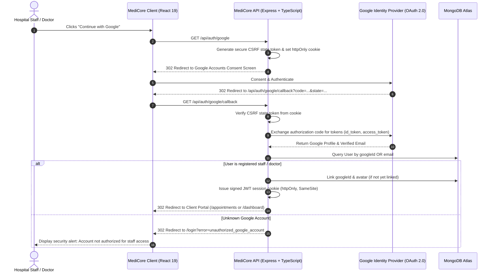
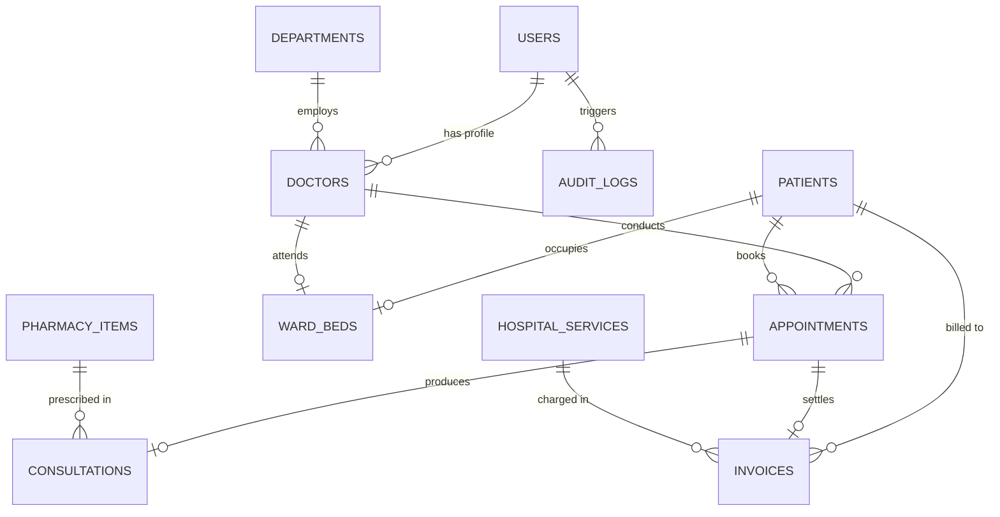
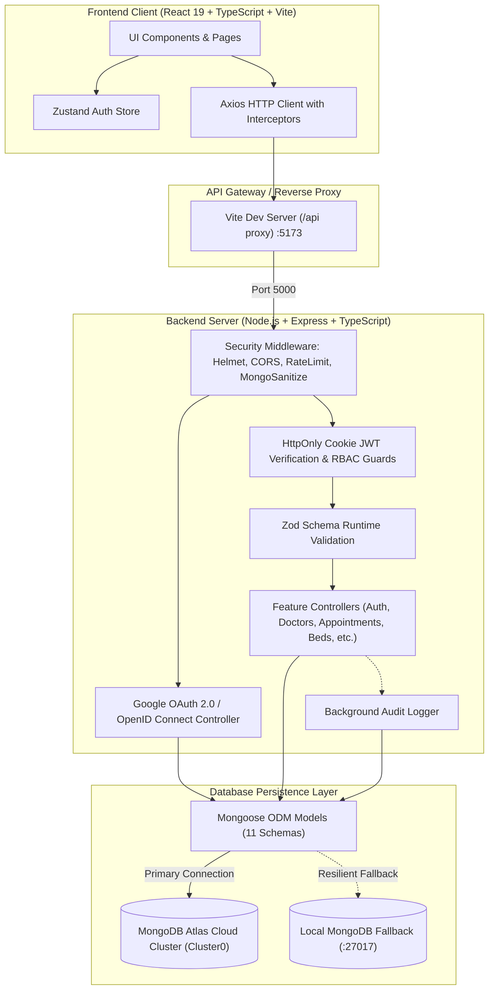

# 🏥 MediCore HMS — Enterprise Hospital Management System

<div align="center">


[](https://react.dev/)
[](https://www.typescriptlang.org/)
[](https://nodejs.org/)
[](https://expressjs.com/)
[](https://www.mongodb.com/atlas)
[](https://developers.google.com/identity/protocols/oauth2)
[](https://tailwindcss.com/)
[](https://vitejs.dev/)
[](https://vitest.dev/)
[](LICENSE)

**A modern, production-grade, full-stack Hospital Management System (HMS) engineered with React 19, TypeScript, Node.js/Express, and MongoDB Atlas.**  
*Includes Enterprise Google OAuth 2.0 SSO, Role-Based Access Control, Doctor Onboarding & Directory Management, Clinical Consultations, Digital Prescriptions, Inpatient Ward & Bed Occupancy, Pharmacy Dispensary Formulary, Diagnostic Test Catalog, Itemized Billing, and Real-Time System Observability.*

[Features](#-key-features--modules) • [Google SSO & Auth Flow](#-google-oauth-20--single-sign-on-sso) • [Doctor Onboarding](#-doctor-onboarding--faculty-management) • [Database Architecture](#-database-architecture-11-collections) • [System Architecture](#-system-architecture) • [Getting Started](#-getting-started) • [API Reference](#-api-specification) • [Viva Guide](#-university-viva--architectural-defense)

</div>

---

## 🌟 Key Features & Modules

### 1. 🛡️ Role-Based Access Control (RBAC) & Persona Workflows
- **4 Distinct User Roles**: `ADMIN`, `DOCTOR`, `RECEPTIONIST`, and `BILLING_STAFF`.
- Strict route-level enforcement on both frontend (`ProtectedRoute`) and backend (`authorize(...roles)` middleware).
- Dynamic navigation sidebar adapting instantly to the active role's clinical permissions.

### 2. 🔐 Google OAuth 2.0 Single Sign-On (SSO) & Security
- **Continue with Google**: One-click authentication with Google OpenID Connect (`email`, `profile`).
- **Cryptographic State Security**: Signed HTTP-only cookie validation preventing OAuth CSRF attacks.
- **Authorized Email Verification**: External unregistered Google accounts are blocked with security alerts, ensuring only verified hospital personnel can enter.
- **Auto Identity Linking**: Existing staff accounts seamlessly link their Google ID upon verification.
- **Profile Google Integration Hub**: Staff can view their connected Google email, avatar, or link/unlink their Google identity from the User Profile page.

### 3. 👨‍⚕️ Medical Faculty & Doctor Onboarding
- **Direct Doctor Registration**: Hospital administrators can register new physicians directly from the `/doctors` directory.
- **Comprehensive Clinical Profiling**: Capture doctor name, Google email, department, clinical specialization, medical qualifications (MBBS, MD, DM), years of experience, standard consultation fee, weekly schedule (MON–SUN), contact phone, and bio.
- **Instant Google Access**: Provisioning a doctor with their Google email enables them to log in immediately via **Continue with Google** with automatic `DOCTOR` role assignment.
- **Directory Controls**: Search, filter by department or specialization, live Google-linked badges, edit schedule/fees, and doctor profile deactivation/deletion with confirmation dialogs.

### 4. 🩺 Clinical Consultation & Electronic Health Records (EHR)
- **Consultation Portal**: Record patient chief complaints, clinical diagnoses (with ICD codes), and physician advice.
- **Dynamic Digital Prescription**: Multi-drug prescription builder with medicine name, dosage, duration, and clinical instructions.
- **Diagnostic Orders**: Link required laboratory and radiology investigations directly to the consultation encounter.

### 5. 🛏️ Inpatient Ward & Bed Occupancy Matrix
- Real-time bed availability tracking across **ICU**, **Private AC**, **General Ward**, and **Emergency**.
- Live occupancy indicators (Available, Occupied, Under Maintenance) with assigned patient, attending physician, and admission timestamp.

### 6. 🧪 Hospital Diagnostic Services & Procedures Directory
- Standardized hospital service catalog (`SRV-LAB01`, `SRV-RAD01`, `SRV-CARD01`, `SRV-ROOM01`).
- Categorized by **Laboratory**, **Radiology**, **Procedure**, and **Room Charges** with fixed pricing.

### 7. 💊 Pharmacy Dispensary & Medicine Stock Formulary
- Hospital medicine formulary tracking tablets, syrups, injections, and inhalers.
- Real-time stock counts, reorder threshold alerts, batch numbers, manufacturer details, and expiry date warnings.

### 8. 📅 Conflict-Aware Outpatient & Emergency Scheduling
- Double-booking prevention algorithm ensuring doctors cannot have conflicting appointment time slots.
- Status management workflow: `SCHEDULED` ➔ `COMPLETED` / `CANCELLED` / `NO_SHOW`.

### 9. 🧾 Itemized Billing, Invoicing & Receipts
- Comprehensive hospital invoice generation calculating consultation fees + dynamic lab/procedure charges - discounts.
- Payment processing across **Cash**, **Card**, **Online (UPI/NetBanking)**, and **Insurance**.
- Printable, tax-compliant invoice modal with hospital branding.

### 10. 📊 Executive Analytics Dashboard
- Interactive financial metrics powered by **Recharts**:
  - Monthly revenue area chart with gradient fills.
  - Appointment volume distribution pie chart by status.
  - Key operational indicators (Total Patients, Today's Appointments, Active Doctors, Pending Invoices).

### 11. 📋 Immutable Audit Log Trail
- Cryptographic-style audit logging capturing actor ID, email, role, action, resource, IP address, and timestamp for all clinical mutations (`DOCTOR_REGISTERED`, `GOOGLE_ACCOUNT_LINKED`, `PATIENT_CREATED`, `APPOINTMENT_SCHEDULED`, etc.).

### 12. 🌐 Real-Time Database Observability Hub
- Live topbar status badge with dynamic network round-trip ping (ms).
- One-click diagnostics modal showing MongoDB Atlas cloud shard status, Mongoose readyState, and live document counts across all 11 collections.

---

## 🔑 Google OAuth 2.0 & Single Sign-On (SSO)

MediCore HMS integrates official Google OAuth 2.0 using the Authorization Code Grant Flow with PKCE/State validation:



---

## 👨‍⚕️ Doctor Onboarding & Faculty Management

MediCore enables Hospital Administrators to seamlessly expand their clinical team:

1. **Add Doctor Form**: Open **Clinical EMR > Doctors** and click **"+ Add New Doctor"**.
2. **Clinical & Schedule Setup**: Fill in doctor credentials, department affiliation, consultation fee, and weekly consulting windows (`MON` through `SUN`).
3. **Automatic SSO Binding**: Entering the doctor's Google email registers them in the hospital database with the `DOCTOR` role.
4. **Instant Access**: The doctor can immediately visit MediCore, click **Continue with Google**, and receive direct access to their assigned appointments, clinical consultations, and digital prescription workflows.
5. **Directory Management**: Edit schedules, update fees, or remove doctors anytime with real-time audit logging.

---

## 🗄️ Database Architecture (11 Collections)

The database schema is designed for full healthcare operational integrity:



| # | Collection | Description | Primary Key / Auto ID | Key Relations & Attributes |
| :--- | :--- | :--- | :--- | :--- |
| 1 | **`users`** | Staff & administrative credentials | `_id` (ObjectId) | `email` (unique), `passwordHash`, `role`, `googleId`, `avatarUrl`, `phone`, `isActive` |
| 2 | **`departments`** | Hospital medical specialties | `_id` (ObjectId) | `name`, `description`, `headDoctorId` ➔ `users` |
| 3 | **`doctors`** | Specialist clinical profiles | `_id` (ObjectId) | `userId` ➔ `users`, `departmentId`, `consultationFee`, `schedule[]`, `experience`, `specialization` |
| 4 | **`patients`** | Electronic health patient records | `patientId` (`P-00001`) | `name`, `dob`, `gender`, `bloodGroup`, `allergies[]`, `emergencyContact` |
| 5 | **`appointments`**| Outpatient & emergency visits | `appointmentId` (`A-00001`)| `patientId`, `doctorId`, `date`, `timeSlot`, `status`, `type` |
| 6 | **`consultations`**| Diagnoses & Rx records | `_id` (ObjectId) | `appointmentId`, `diagnosis`, `prescription[]`, `labTests[]` |
| 7 | **`invoices`** | Itemized hospital bills | `invoiceId` (`INV-00001`) | `patientId`, `appointmentId`, `totalAmount`, `paidAmount`, `status` |
| 8 | **`hospitalservices`**| Diagnostic & procedure catalog | `code` (`SRV-LAB01`) | `name`, `category`, `price`, `description` |
| 9 | **`pharmacyitems`**| Dispensary medicine formulary | `code` (`MED-001`) | `genericName`, `dosageStrength`, `stockQuantity`, `reorderLevel`, `expiryDate` |
| 10| **`wardbeds`** | Ward & ICU bed management | `bedNumber` (`ICU-01`) | `wardType`, `floor`, `dailyRate`, `status`, `currentPatientId` |
| 11| **`auditlogs`** | Tamper-evident mutation log | `_id` (ObjectId) | `userId`, `userRole`, `action`, `resource`, `ipAddress`, `timestamp` |

---

## 🏗️ System Architecture



---

## 🚀 Getting Started

### 1. Prerequisites
- **Node.js**: v18.0.0 or higher ([Download Node.js](https://nodejs.org/))
- **npm**: v9.0.0 or higher
- **MongoDB**: MongoDB Atlas Cloud Cluster account OR Local MongoDB Community Server
- **Google Cloud Console** *(Optional for Google SSO)*: OAuth 2.0 Client ID & Secret configured with authorized redirect URI `http://localhost:5000/api/auth/google/callback`

### 2. Clone the Repository
```bash
git clone https://github.com/itsnotdevill/MEDICORE-Hospital-Management-System-.git
cd MEDICORE-Hospital-Management-System-
```

### 3. Install Dependencies
```bash
# Install root dependencies
npm install

# Install server dependencies
cd server && npm install && cd ..

# Install client dependencies
cd client && npm install && cd ..
```

### 4. Configure Environment Variables
Create `server/.env` (a template is provided in `server/.env.example`):
```env
PORT=5000
NODE_ENV=development
MONGODB_URI=mongodb+srv://<username>:<password>@cluster0.a9jzgrg.mongodb.net/medicore_db?retryWrites=true&w=majority
JWT_SECRET=medicore_super_secure_jwt_secret_development_key_university_project_2026
JWT_EXPIRES_IN=15m
CLIENT_ORIGIN=http://localhost:5173

# Google OAuth 2.0 Credentials
GOOGLE_CLIENT_ID=your-google-client-id.apps.googleusercontent.com
GOOGLE_CLIENT_SECRET=your-google-client-secret
GOOGLE_CALLBACK_URL=http://localhost:5000/api/auth/google/callback
```

> [!TIP]
> **Zero Configuration Fallback**: If `MONGODB_URI` is not provided or Atlas credentials are being set up, MediCore automatically connects to local MongoDB (`mongodb://127.0.0.1:27017/medicore_db`) so the app never fails!

### 5. Seed Database (All 11 Collections)
Seed the database with rich clinical test data:
```bash
# Seed to your currently active database (Local or Atlas)
npm run seed

# OR seed directly to MongoDB Atlas Cloud Cluster
npm run seed:atlas
```

### 6. Start Development Servers
Run both backend and frontend concurrently:
```bash
# In Terminal 1 - Backend Server (Port 5000)
npm run dev:server

# In Terminal 2 - Frontend Client (Port 5173)
npm run dev:client
```
Open **`http://localhost:5173`** in your browser.

---

## 👥 Demo User Credentials

The application includes pre-configured personas ready for demonstration:

| Role | Email | Password | Primary Capabilities |
| :--- | :--- | :--- | :--- |
| 🛡️ **Hospital Admin** | `admin@medicore.dev` | `Admin@12345` | Full system control, doctor onboarding, audit logs, revenue analytics, bed & pharmacy oversight |
| 🛡️ **Google Admin** | `itsnotdevill@gmail.com` | `Password123!` | Direct Google OAuth 1-click admin login & management |
| 🩺 **Senior Doctor** | `dr.sharma@medicore.dev` | `Doctor@12345` | Clinical queue, consultations, digital prescription builder, lab orders, patient medical histories |
| 🏥 **Receptionist** | `reception@medicore.dev` | `Reception@12345` | Patient registration, appointment scheduling, doctor directory, inpatient bed inquiry |
| 💳 **Billing Staff** | `billing@medicore.dev` | `Billing@12345` | Invoice generation, diagnostic fee additions, payment settlement, printable tax receipts |

*(Standard login credentials can also be auto-filled with 1-click directly on the Sign In page)*

---

## 📡 API Specification

| Method | Endpoint | Description | Access |
| :--- | :--- | :--- | :--- |
| `POST` | `/api/auth/login` | Authenticate staff & issue HttpOnly JWT cookie | Public |
| `POST` | `/api/auth/register` | Register new hospital staff / doctor | Public |
| `POST` | `/api/auth/logout` | Clear auth cookie & revoke session | Authenticated |
| `GET` | `/api/auth/me` | Fetch active user profile & privileges | Authenticated |
| `GET` | `/api/auth/google` | Initiate Google OAuth 2.0 consent flow | Public |
| `GET` | `/api/auth/google/callback` | Handle Google OAuth code exchange & issue JWT | Public |
| `POST` | `/api/auth/google/link` | Link Google account to existing user with password | Authenticated |
| `POST` | `/api/auth/google/unlink` | Unlink Google identity from user profile | Authenticated |
| `GET` | `/api/system/status` | Real-time DB latency, 11 collection counts & security state | Public |
| `GET` | `/api/doctors` | List doctors with specialties, schedules & fees | All Roles |
| `POST` | `/api/doctors` | Register new doctor with user credentials & schedule | Admin |
| `PUT` | `/api/doctors/:id` | Update doctor qualifications, fee, or schedule | Admin |
| `DELETE` | `/api/doctors/:id` | Deactivate/remove doctor from active directory | Admin |
| `GET` | `/api/patients` | Paginated patient list with query search | Admin, Receptionist |
| `POST` | `/api/patients` | Register new electronic patient health record | Admin, Receptionist |
| `GET` | `/api/appointments` | List appointments with doctor/date filters | Admin, Receptionist, Doctor |
| `POST` | `/api/appointments` | Create appointment with conflict detection | Admin, Receptionist, Doctor |
| `POST` | `/api/consultations` | Save clinical diagnosis, Rx list & lab tests | Doctor |
| `GET` | `/api/invoices` | List invoices with status & patient filters | Admin, Billing |
| `POST` | `/api/invoices` | Generate invoice with dynamic charges | Admin, Billing |
| `PUT` | `/api/invoices/:id` | Process partial or full payment settlement | Admin, Billing |
| `GET` | `/api/beds` | Real-time ward & ICU bed occupancy matrix | Admin, Doctor, Receptionist |
| `PUT` | `/api/beds/:id/status`| Admit patient / discharge bed | Admin, Receptionist |
| `GET` | `/api/pharmacy` | List medication inventory & stock levels | Admin, Doctor, Billing |
| `PUT` | `/api/pharmacy/:id/stock`| Update inventory quantities | Admin, Billing |
| `GET` | `/api/services` | Diagnostic laboratory & radiology test catalog | Admin, Doctor, Billing |
| `GET` | `/api/reports/dashboard`| Aggregate revenue & appointment statistics | Admin |
| `GET` | `/api/reports/audit-logs`| System audit trail events | Admin |

---

## 🧪 Testing & Quality Assurance

MediCore HMS includes an automated backend test suite powered by **Vitest**:
```bash
# Run Vitest test suite (Health, Security, Google OAuth tests)
npm run test:server

# Run TypeScript type check across client & server
npm run type-check

# Run production bundle builds
npm run build:server
npm run build:client
```

---

## 🎓 University Viva & Architectural Defense

### Q1: Why store JWT in an `httpOnly` cookie instead of `localStorage`?
> **Answer**: `localStorage` is accessible by any client-side JavaScript executing in the browser. In the event of a Cross-Site Scripting (XSS) vulnerability, an attacker can extract tokens directly. An `httpOnly` cookie is inaccessible to JavaScript via `document.cookie`, meaning tokens cannot be stolen via XSS, while the browser automatically attaches it to same-origin requests.

### Q2: How does the Google OAuth 2.0 flow prevent unauthorized external account access?
> **Answer**: During the OAuth callback, the backend exchanges the authorization code for verified Google user profile data (`email`, `email_verified`). Rather than blindly creating accounts for any public Google user, MediCore cross-checks the email against the hospital database. If the email does not correspond to an authorized staff member or pre-registered doctor, access is rejected with an `unauthorized_google_account` error, preserving strict zero-trust hospital security. Furthermore, CSRF state cookies prevent authorization code injection attacks.

### Q3: How does the Doctor Onboarding lifecycle grant immediate role-based access for Google SSO?
> **Answer**: When an administrator registers a new doctor, the system atomically provisions both a `User` account (with role `DOCTOR` and the doctor's Google email) and a linked `Doctor` clinical profile. When the doctor later signs in with "Continue with Google", the backend matches their verified Google email to their `User` record, links their `googleId`, and issues an authenticated session granting access to Doctor Portal routes (`/appointments`, consultations, EHR).

### Q4: How does MediCore prevent double-booking of doctors?
> **Answer**: During appointment creation, the backend runs an atomic query checking if an active appointment (`status: { $ne: 'CANCELLED' }`) already exists for the designated `doctorId` at the selected `date` and `timeSlot`. If a match exists, a `409 Conflict` HTTP error is returned.

### Q5: How is financial data integrity guaranteed during invoice generation?
> **Answer**: Invoices calculate the total amount deterministically on the server:
> $$\text{Total Amount} = \text{Consultation Fee} + \sum(\text{Additional Charges}) - \text{Discount}$$
> The client cannot tamper with the final total, and all numeric fields are strictly validated via Zod schemas.

### Q6: How is high availability achieved with MongoDB Atlas?
> **Answer**: The database connection layer in `server/src/config/database.ts` establishes an encrypted connection to the multi-region MongoDB Atlas replica set (`Cluster0`) using Google Public DNS (`8.8.8.8`) to prevent Windows SRV lookup timeouts. If network degradation occurs, a local fallback is initiated automatically.

---

## 📜 License

Distributed under the **MIT License**. See `LICENSE` for details.

---

<div align="center">
  <b>Developed for University Final-Year Project Demonstration</b><br>
  Built with ❤️ using React 19, TypeScript, Express, and MongoDB Atlas.
</div>
